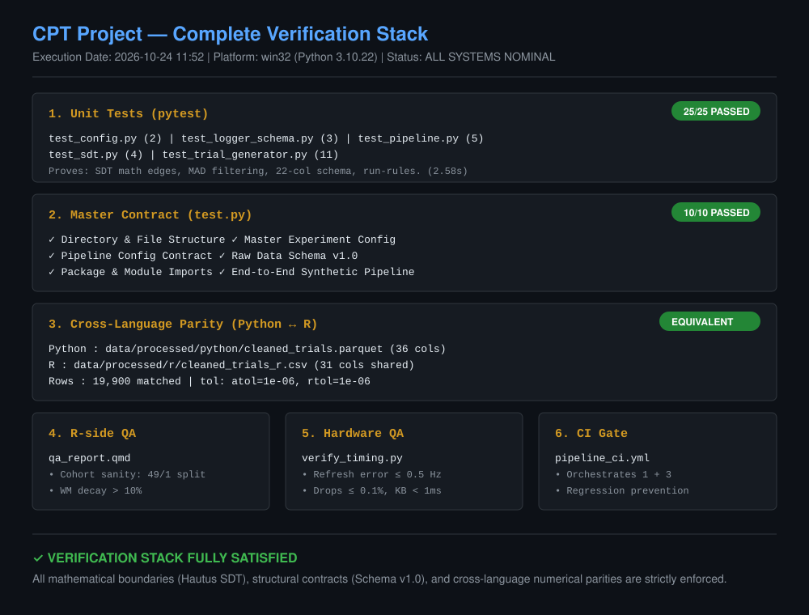
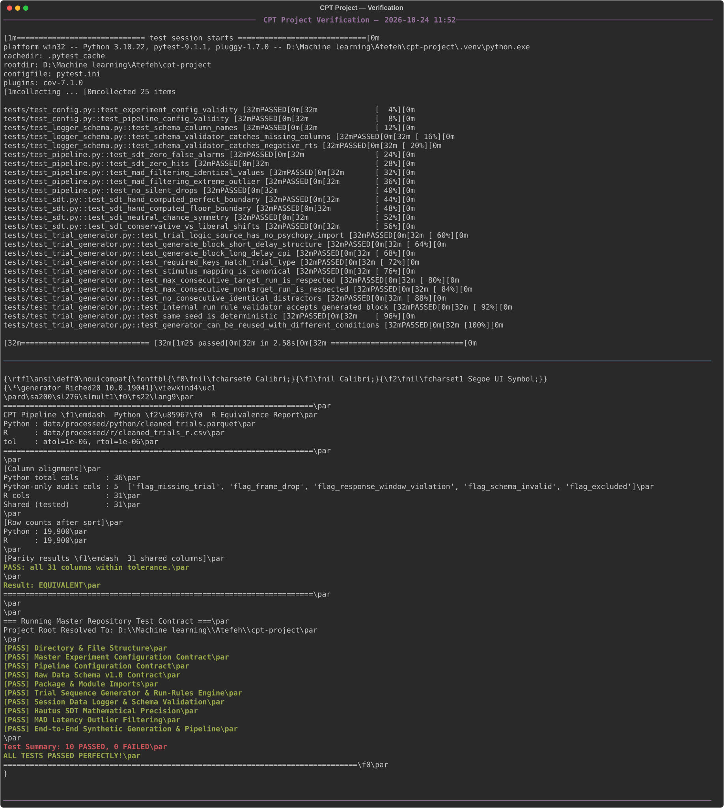
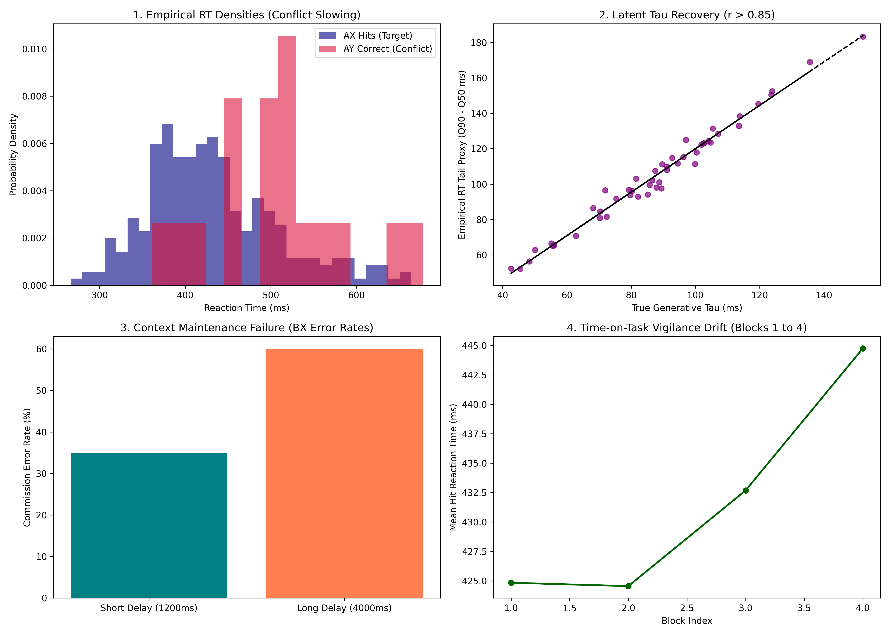

# Behavioral Paradigm Design & Psychometric Pipeline Preparation

### A reproducible Dual-Delay AX-CPT paradigm with polyglot (Python / R) psychometric pipelines

[](https://github.com/Atefeh-Nouri/Behavioral-Paradigm-Design-Psychometric-Pipeline-Preparation/actions)

-blue)


> ⚠️ **Research-use only.** This repository is an investigational measurement instrument. It is **not a medical device** and produces **no clinical diagnosis**. See [§12 — Ethical Governance](#12-research-use-only--ethical-governance).

**Status:** v1.0 frozen — synthetic validation complete · cross-language parity verified · empirical pilot pending.
**Quality gate:** 25/25 pytest unit tests · 10/10 master-contract checks · Python ↔ R equivalence: **EQUIVALENT**.

---

## 1. At a Glance

| Dimension | Value |
|---|---|
| Paradigm | Dual-Delay AX-CPT · 400 trials (4 blocks × 100) · 70/10/10/10 AX/AY/BX/BY |
| Delay manipulation | 1200 ms vs 4000 ms cue–probe interval, blocked ABBA / BAAB |
| Latent constructs | Sustained attention · Inhibitory control · Working-memory context maintenance |
| Execution engines | PsychoPy Coder (Python 3.11, V-Sync frame-quantized) · OpenSesame 4.x parity build |
| Scoring model | Ex-Gaussian latency decomposition + Hautus (1995) log-linear Signal Detection Theory |
| Synthetic benchmark | N = 50 subjects × 400 trials (19,974 realized rows) · seed 2026 · SHA-256 manifest |
| Analysis pipelines | Python (`pandas`/`scipy`) and R (`tidyverse`/`arrow`), parity-verified at Δ ≤ 1e-6 |
| Documentation | 30-file methodological suite (`docs/`), Days 1–30 |

---

## 2. Abstract

This repository provides an open-source, reproducible psychophysical experimental paradigm and computational psychometric processing pipeline designed to dissociate three core latent executive functions: **Sustained Attention (Tonic Vigilance)**, **Inhibitory Control (Motor Response Suppression)**, and **Working Memory Context Maintenance**.

The platform implements a standardized Dual-Delay AX-Continuous Performance Test (AX-CPT) across PsychoPy Coder and OpenSesame 4.x, backed by a hierarchical Monte Carlo synthetic data generator and twin analytical pipelines in Python and R. All cleaning is **non-destructive** (flag, never delete), all scoring uses **Hautus log-linear corrections** for zero-cell stability, and all cross-language outputs are **numerically parity-verified** in continuous integration.

---

## 3. Motivation & Context

This project stems from nearly a decade of applied experience in educational consulting and behavioral intervention (school environments and families of children on the autism spectrum), where breakdowns in goal maintenance, attention regulation, and behavioral inhibition frequently manifest as academic and emotional challenges — yet subjective rating scales cannot quantify them.

This repository bridges that gap with a sub-millisecond computational framework that objectively decomposes **proactive vs. reactive cognitive control**. It is a research-use assessment pipeline, **not** a standalone clinical diagnostic device.

---

## 4. Scientific Design Overview

| Feature | Value | Why it matters |
|---|---|---|
| Trials | 400 (4 × 100) | ≥100 trials per main cell for stable RT-tail estimation |
| Cell mix | 70% AX · 10% AY · 10% BX · 10% BY | Strong target prepotency → clean inhibition contrast |
| Cue–probe delay | 1200 ms vs 4000 ms (ABBA/BAAB) | Isolates WM context decay from order/fatigue effects |
| Stimulus timing | 300 ms = 18 frames @ 60 Hz | Frame-quantized (V-Sync) presentation, not wall-clock sleep |
| Response window | 1000 ms | Later responses scored as omission errors |
| Anticipation guard | RT < 150 ms flagged | Below human visual–motor minimum; not a cognitive decision |
| Run rules | ≤4 consecutive AX · ≤2 consecutive non-targets · no repeated distractor | Prevents motor entrainment and rhythm guessing |
| Primary metrics | Ex-Gaussian τ & ICV · omission rate · AY/BX commissions · d′, c (Hautus) · PBI · PES · vigilance slope | Separates lapses, inhibition, context maintenance, and response bias |

---

## 5. Verification Dashboard

<p align="center">
  
</p>

<p align="center">
  
</p>

<p align="center">
  
</p>

**Figure captions.** *Top:* six-layer verification stack. *Middle:* live terminal log (25/25 pytest, 10/10 contract, parity EQUIVALENT over 19,900 rows × 31 shared columns). *Bottom:* Monte Carlo validation — conflict slowing (AY > AX RT), latent τ recovery, BX error increase under long delay (WM decay), and time-on-task vigilance drift.

### Verification layers

| Layer | Artifact | Scope | Command |
|---|---|---|---|
| 1. Unit tests | `tests/test_*.py` | 25 tests: SDT edges, MAD filtering, 22-col schema, run-rules, config bounds | `python -m pytest tests/ -v` |
| 2. Master contract | `test.py` | 10 checks: layout, configs, schema, imports, end-to-end pipeline | `python test.py` |
| 3. Cross-language parity | `tests/verify_equivalence.py` | 31 shared columns × 19,900 rows, Δ ≤ 1e-6 | `python tests/verify_equivalence.py` |
| 4. R-side QA | `analysis_r/qa_report.qmd` | Cohort sanity assertions (compliance split, hit rate, slowing, decay) | `quarto render analysis_r/qa_report.qmd` |
| 5. Hardware timing QA | `tests/verify_timing.py` | Refresh error ≤ 0.5 Hz · drops ≤ 0.1% · keyboard overhead < 1 ms | `python tests/verify_timing.py` |
| 6. CI gate | `.github/workflows/pipeline_ci.yml` | Orchestrates layers 1 + 3 + both pipelines on every push | automatic |

---

## 6. Repository Structure

```text
📁 cpt-project
├── 📁 analysis_python          # D6 — Python psychometric pipeline
│   ├── 🐍 __init__.py
│   ├── 🐍 clean.py
│   ├── 🐍 cpt_pipeline.py
│   ├── 🐍 ingest.py
│   ├── 🐍 sdt.py
│   └──  summarize.py
├──  analysis_r               # D7 — R tidyverse psychometric pipeline
│   ├── 📈 cpt_cleaning_pipeline.R
│   ├── 📓 qa_report.qmd
│   └──  renv.lock
├── 📁 config                   # Single source of truth
│   ├── ⚙️ config.yaml
│   ├── ⚙️ pipeline_config.yaml
│   └── 🧾 schema_raw_v1.json
├── 📁 data                     # Git-ignored payloads (structure only)
│   ├── 📁 processed
│   └── 📁 raw
├── 📁 docs                     # 30-day methodological suite + figures
│   ├── 📁 assets
│   │   └── 🖼️ benchmark_validation_diagnostics.png
│   ├── 📝 01_construct_definition_matrix.md
│   ├── 📝 02_literature_synthesis_matrix_a.md
│   ├── 📝 03_experimental_design.md
│   ├── 📝 04_timing_state_machine_schema.md
│   ├── 📝 05_psd_v1_frozen.md
│   ├── 📝 06_repo_scaffolding_and_config.md
│   ├── 📝 07_psychopy_timing_engine_spec.md
│   ├── 📝 08_psd_code_traceability_matrix.md
│   ├── 📝 09_logging_contracts_and_simulated_traces.md
│   ├── 📝 10_timing_qa_protocol.md
│   ├── 📝 11_opensesame_build_and_parity_guide.md
│   ├── 📝 12_pilot_protocol_and_triage_tree.md
│   ├── 📝 13_synthetic_data_model_specification.md
│   ├── 📝 14_single_subject_validation_report.md
│   ├── 📝 15_injected_anomaly_manifest.md
│   ├── 📝 16_synthetic_benchmark_manifest.md
│   ├── 📝 17_generator_validation_and_freeze_report.md
│   ├── 📝 18_benchmark_data_dictionary.md
│   ├── 📝 19_pipeline_architecture_and_contracts.md
│   ├── 📝 20_ingestion_validation_report.md
│   ├── 📝 21_cleaning_and_sdt_spec.md
│   ├── 📝 22_r_pipeline_and_quarto_qa_guide.md
│   ├── 📝 23_cross_language_equivalence_report.md
│   ├── 📝 24_testing_and_ci_specification.md
│   ├── 📝 25_benchmark_analysis_and_reproducibility.md
│   ├── 📝 26_cognitive_ergonomics_matrix_b1.md
│   ├── 📝 27_cdss_architecture_and_contracts.md
│   ├── 📝 28_diagnostic_reasoning_matrix_b2.md
│   ├── 📝 29_final_methodological_report.md
│   └── 📝 30_executive_summary_and_closeout.md
├──  paradigms
│   ├── 📁 opensesame           # D3 — OpenSesame parity build
│   │   ├── 📁 inline_scripts
│   │   │   ├── 🐍 feedback_eval.py
│   │   │   ├── 🐍 init_experiment.py
│   │   │   ├── 🐍 score_trial.py
│   │   │   └── 🐍 trial_init.py
│   │   └── 📝 BUILD_STEPS.md
│   └──  psychopy             # D2 — PsychoPy Coder engine
│       ├── 🐍 __init__.py
│       ├── 🐍 config_loader.py
│       ├── 🐍 engine.py
│       ├── 🐍 logger.py
│       ├── 🐍 main.py
│       ├── 🐍 trial_executor.py
│       ├── 🐍 trial_logic.py
│       └── 🐍 ui.py
├── 📁 reports                  # Verification figure generation
│   ├── make_combined_svg.py
│   ├── tech_stack.svg
│   ├── verification_stack.svg
│   └── verification.svg
├── 📁 synthetic_data           # D5 — Monte Carlo benchmark generator
│   ├── 🐍 __init__.py
│   ├── 🐍 generate_benchmark.py
│   └──  generator.py
├── 📁 tests                    # Verification & QA harnesses
│   ├── 🐍 __init__.py
│   ├── 🐍 plot_diagnostics.py
│   ├── 🧪 test_config.py
│   ├── 🧪 test_logger_schema.py
│   ├── 🧪 test_pipeline.py
│   ├── 🧪 test_sdt.py
│   ├── 🧪 test_trial_generator.py
│   ├── 🐍 verify_equivalence.py
│   └── 🐍 verify_timing.py
├── 🗂️ PROJECT_STRUCTURE.md
├── 🧪 pytest.ini
├── 📖 README.md
├── 📦 requirements-ci.txt
├── 📦 requirements.txt
└──  test.py
```

---

## 7. Component Glossary

### `analysis_python/` — Deliverable D6
| File | Purpose |
|---|---|
| `clean.py` | Non-destructive within-subject MAD outlier filtering (flag, never delete) |
| `cpt_pipeline.py` | Master CLI orchestrator: ingest → clean → score → summarize |
| `ingest.py` | Schema validation, duplicate/continuity auditing, compliance gating |
| `sdt.py` | Hautus (1995) log-linear SDT scoring (d′, c) with zero-cell stability |
| `summarize.py` | 24-column subject-level aggregation (Data Contract 2) |

### `analysis_r/` — Deliverable D7
| File | Purpose |
|---|---|
| `cpt_cleaning_pipeline.R` | Parity-verified tidyverse/arrow mirror of the Python pipeline |
| `qa_report.qmd` | Quarto automated statistical assertion report |
| `renv.lock` | Strict R dependency lockfile for reproducibility |

### `config/` — Single source of truth
| File | Purpose |
|---|---|
| `config.yaml` | Master paradigm configuration (timing, stimuli, run-rules, blocks) |
| `pipeline_config.yaml` | Cleaning thresholds, MAD constants, SDT parameters |
| `schema_raw_v1.json` | JSONSchema draft-07 contract for the 22-column Raw Data Schema |

### `paradigms/psychopy/` — Deliverable D2
| File | Purpose |
|---|---|
| `config_loader.py` | Pydantic-backed YAML validation |
| `engine.py` | V-Sync hardware timing, frame-budget watchdog, clock management |
| `logger.py` | Raw Data Schema v1.0 enforcement and atomic writes |
| `main.py` | Entrypoint: CLI args, block sequencing, session lifecycle |
| `trial_executor.py` | Deterministic trial state machine and keyboard polling |
| `trial_logic.py` | Bounded rejection-sampling run-rule engine (pure Python, CI-safe) |
| `ui.py` | Criterion-gated practice and countdown rest interfaces |

### `paradigms/opensesame/` — Deliverable D3
| File | Purpose |
|---|---|
| `BUILD_STEPS.md` | Step-by-step GUI build guide (<30 min setup) |
| `inline_scripts/*.py` | Init, trial-init, scoring, and feedback inline logic |

### `synthetic_data/` — Deliverable D5
| File | Purpose |
|---|---|
| `generator.py` | Hierarchical Ex-Gaussian latency + SDT threshold simulator |
| `generate_benchmark.py` | Batch engine: N=50 × 400 trials with cryptographic manifest |

### `tests/` — Verification harnesses
| File | Purpose |
|---|---|
| `test_config.py` | YAML bounds and schema integrity assertions |
| `test_logger_schema.py` | 22-column schema enforcement and negative-RT rejection |
| `test_pipeline.py` | MAD edge cases (identical values, extreme outliers), no-silent-drop |
| `test_sdt.py` | Hand-computed Hautus SDT boundary cases (0% / 100% rates) |
| `test_trial_generator.py` | Cell balancing, run-rules, distractor-repeat, determinism |
| `verify_equivalence.py` | Python ↔ R numerical parity audit (Δ ≤ 1e-6) |
| `verify_timing.py` | Display refresh jitter and keyboard latency benchmarks |
| `plot_diagnostics.py` | Benchmark validation figure generation |

### Root
| File | Purpose |
|---|---|
| `test.py` | Master Repository Test Contract (10 structural + end-to-end checks) |
| `pytest.ini` | Pytest path and collection configuration |
| `requirements.txt` / `requirements-ci.txt` | Pinned production / lightweight CI dependencies |
| `PROJECT_STRUCTURE.md` | High-level architectural map |

---

## 8. Documentation Index (`docs/`)

| # | File | Contents |
|---|---|---|
| 01 | construct_definition_matrix | Constructs → observable metrics, confounds, validity risks |
| 02 | literature_synthesis_matrix_a | Evidence base for every timing/scoring parameter |
| 03 | experimental_design | Final design: trials, blocks, counterbalancing, practice gate |
| 04 | timing_state_machine_schema | Millisecond chronometry, FSM, event codes, 22-column schema |
| 05 | psd_v1_frozen | **Frozen PSD v1.0** — the contract all other files obey |
| 06 | repo_scaffolding_and_config | Folder layout and config-centralization principle |
| 07 | psychopy_timing_engine_spec | V-Sync flips, non-slip clocks, drop watchdog rationale |
| 08 | psd_code_traceability_matrix | PSD requirement → implementing code module |
| 09 | logging_contracts_and_simulated_traces | Write-time contract + example raw rows |
| 10 | timing_qa_protocol | Hardware thresholds + operator pre-flight checklist |
| 11 | opensesame_build_and_parity_guide | OpenSesame rebuild and timing parity table |
| 12 | pilot_protocol_and_triage_tree | Pilot acceptance criteria and config/code/PSD triage |
| 13 | synthetic_data_model_specification | Generator mathematics (traits, Ex-Gaussian, SDT, artifacts) |
| 14 | single_subject_validation_report | One simulated subject vs theoretical targets |
| 15 | injected_anomaly_manifest | ANOM-01…06 and required pipeline responses |
| 16 | synthetic_benchmark_manifest | Seeds, SHA-256 hashes, freeze status |
| 17 | generator_validation_and_freeze_report | Parameter recovery + freeze sign-off |
| 18 | benchmark_data_dictionary | Column-by-column semantics of the benchmark |
| 19 | pipeline_architecture_and_contracts | Shared Python/R architecture, Data Contracts 1 & 2 |
| 20 | ingestion_validation_report | 50 sessions: 49 compliant, 1 rejected (with reasons) |
| 21 | cleaning_and_sdt_spec | MAD rules and Hautus SDT formulas |
| 22 | r_pipeline_and_quarto_qa_guide | R pipeline guide + Quarto assertions |
| 23 | cross_language_equivalence_report | Python-vs-R parity sign-off |
| 24 | testing_and_ci_specification | Test layers and CI job description |
| 25 | benchmark_analysis_and_reproducibility | Cohort norms, split-half reliability, reproduction commands |
| 26 | cognitive_ergonomics_matrix_b1 | Metric → human-factors construct mapping with inference limits |
| 27 | cdss_architecture_and_contracts | Research-use decision-support architecture and guardrails |
| 28 | diagnostic_reasoning_matrix_b2 | Automation bias / alert fatigue literature → design decisions |
| 29 | final_methodological_report | Final academic-style methodological report |
| 30 | executive_summary_and_closeout | Self-audit, deliverable registry, roadmap |

---

## 9. Quickstart

```bash
# 1. Environment
python -m venv .venv
source .venv/Scripts/activate        # Git Bash on Windows
python -m pip install --upgrade pip
python -m pip install -r requirements.txt

# 2. Synthetic benchmark (D5)
python synthetic_data/generate_benchmark.py --config config/config.yaml --seed 2026

# 3. Python pipeline (D6)
python analysis_python/cpt_pipeline.py --config config/pipeline_config.yaml

# 4. Test suites (25 unit + 10 contract)
python -m pytest tests/ -v
python test.py

# 5. R pipeline (D7) — Option A: renv
Rscript -e "install.packages('renv'); renv::restore()"
Rscript analysis_r/cpt_cleaning_pipeline.R
#    Option B (Windows/Conda fallback):
# conda install -c conda-forge --override-channels r-base r-arrow r-dplyr r-purrr r-readr r-tibble r-stringr r-yaml -y

# 6. Cross-language equivalence
python tests/verify_equivalence.py
```

---

## 10. Data Contracts

- **Raw Data Schema v1.0** — 22-column trial telemetry, enforced by `config/schema_raw_v1.json`.
- **Data Contract 1 (Cleaned Trials)** — Parquet; all raw columns retained plus non-destructive boolean audit flags (`flag_mad_outlier`, `flag_anticipation`, `is_retained_for_rt`, …).
- **Data Contract 2 (Subject Summaries)** — 24-column CSV; Hautus SDT indices (d′_global, d′_context, c), latency summaries, PBI, vigilance slope.
- **Parity note** — Python emits 5 additional hardware-telemetry audit flags native to the PsychoPy engine; the verified shared contract is **31 columns**.

---

## 11. Known Limitations (accepted for v1.0)

1. **Timing jitter seeding** — realized timing noise in `generator.py` uses unseeded `np.random` calls; minor ms jitter across batch runs.
2. **MAD degenerate-case clamping** — zero-valid-RT subjects return `[150.0, 2000.0]`; one adversarial test asserts a stricter clamp. To be harmonized.
3. **Hardcoded continuity range** — `ingest.py` asserts trials 1–400 instead of reading `config["design"]["total_experimental_trials"]`.
4. **Dedup tie-breaking** — pandas/R `duplicated()` agree under natural ordering, but pre-dedup sort invariants must be explicit in `verify_equivalence.py`.
5. **τ proxy plot** — diagnostics panel uses a linear quantile proxy (Q90 − Q50), not a full ML Ex-Gaussian fit.

All five are documented, non-blocking for synthetic validation, and scheduled for hardening before empirical data collection.

---

## 12. Research-Use Only & Ethical Governance

1. **Non-Diagnostic Mandate.** This software is not a medical device and has not been cleared or approved by the US FDA, European Medicines Agency, or any international regulatory authority. It must not be used for clinical diagnostic evaluation, triage, or medical decision-making regarding ADHD, schizophrenia, traumatic brain injury, or mild cognitive impairment.
2. **No Autonomous Decision-Making.** The architecture prohibits autonomous clinical scoring. All metrics are descriptive psychometric estimates for human-in-the-loop analysis with mandatory display of 95% Bayesian Highest Density Intervals.
3. **Data Privacy.** Keystroke-level timing logs are sensitive behavioral data. All stores use pseudonymous UUIDs with personal identifiers kept in an isolated identity vault.

---

## 13. Roadmap & Citation

**Roadmap:** hardware-verified pilot (N=5) → OSF preregistration → empirical cohort (N=60) → hierarchical Bayesian / HDDM extension → pupillometry multimodality.

**Cite as:** Nouri, A. (2026). *Behavioral Paradigm Design & Psychometric Pipeline Preparation* (v1.0.0) [Computer software]. GitHub. https://github.com/Atefeh-Nouri/Behavioral-Paradigm-Design-Psychometric-Pipeline-Preparation
````
