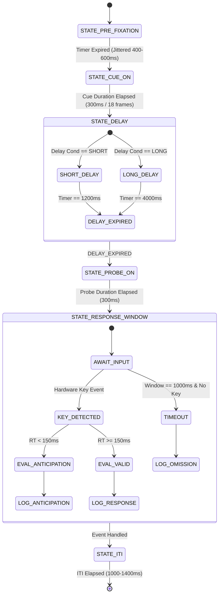

# Timing Specification, State Machine & Raw Data Schema (Day 4)

## 1. Millisecond-Level Timing Specification

```
Timeline of a Single AX-CPT Trial:
┌──────────────┬──────────────┬──────────────────┬──────────────┬──────────────┐
│ Fixation     │ Cue Stimulus │ Delay (CPI)      │ Probe Target │ ITI          │
│ 400–600 ms   │ 300 ms       │ Short: 1200 ms   │ 300 ms       │ 1000–1400 ms │
│ (Jittered)   │ (18 Frames)  │ Long:  4000 ms   │ (18 Frames)  │ (Jittered)   │
└──────────────┴──────────────┴──────────────────┴──────────────┴──────────────┘
                              ▲                  ▲
                              │                  └─ Response Window (1000 ms) ─►
                              Event 30: CUE_ON   Event 40: PROBE_ON
```

### Frame-Quantization Table (60 Hz vs. 144 Hz)

| Event | Target Time ($\text{ms}$) | 60 Hz Budget ($16.667\,\text{ms}/\text{frame}$) | Realized 60 Hz Time | 144 Hz Budget ($6.944\,\text{ms}/\text{frame}$) | Realized 144 Hz Time | Synchronization Mechanism |
| :--- | :--- | :--- | :--- | :--- | :--- | :--- |
| **Fixation** | $500 \pm 100$ | 24 to 36 frames | 400.0 to 600.0 ms | 58 to 86 frames | 402.8 to 597.2 ms | Refresh-synced (`win.flip()`) |
| **Cue Presentation** | 300 ms | **18 frames** | 300.0 ms | **43 frames** | 298.6 ms | Refresh-synced (`win.flip()`) |
| **Delay (Short)** | 1200 ms | **72 frames** | 1200.0 ms | **173 frames** | 1201.4 ms | Non-slip clock schedule |
| **Delay (Long)** | 4000 ms | **240 frames** | 4000.0 ms | **576 frames** | 4000.0 ms | Non-slip clock schedule |
| **Probe Presentation**| 300 ms | **18 frames** | 300.0 ms | **43 frames** | 298.6 ms | Refresh-synced (`win.flip()`) |
| **Response Window** | 1000 ms | Clamped at 1000.0 ms | 1000.0 ms | Clamped at 1000.0 ms | 1000.0 ms | Precision hardware clock |
| **ITI** | $1200 \pm 200$| 60 to 84 frames | 1000.0 to 1400.0 ms | 144 to 202 frames | 1000.0 to 1402.8 ms| Non-slip clock schedule |

---

## 2. Trial State Machine



---

## 3. System Event Codes & Raw Data Schema v1.0

### Event Telemetry Codes
- `10`: `EVENT_TRIAL_INIT`
- `20`: `EVENT_FIX_ONSET`
- `30`: `EVENT_CUE_ONSET`
- `31`: `EVENT_CUE_OFFSET`
- `40`: `EVENT_PROBE_ONSET`
- `41`: `EVENT_PROBE_OFFSET`
- `50`: `EVENT_KEY_DOWN`
- `60`: `EVENT_TRIAL_EVAL`
- `70`: `EVENT_ITI_ONSET`
- `99`: `EVENT_FRAME_DROP`

### Raw Data Schema v1.0 (22 Columns)

| Column Name | Data Type | Units / Format | Nullable | Example | Validation & Description Constraints |
| :--- | :--- | :--- | :---: | :--- | :--- |
| `session_id` | `VARCHAR(64)` | UUIDv4 string | No | `"9b1deb4d-3b7d-4bad-9bdd-2b0d7b3dcb6d"` | Global session identifier. |
| `participant_id` | `VARCHAR(32)` | Alphanumeric | No | `"P042"` | Participant tracking ID. |
| `block_index` | `INT16` | Integer index ($1\text{--}4$) | No | `1` | Block index within session. |
| `block_condition` | `VARCHAR(16)` | Categorical string | No | `"SHORT_DELAY"` | Values: `["SHORT_DELAY", "LONG_DELAY"]`. |
| `trial_index_global` | `INT16` | Integer index ($1\text{--}400$) | No | `142` | Monotonically increasing across the session. |
| `trial_index_block` | `INT16` | Integer index ($1\text{--}100$) | No | `42` | Monotonically increasing within block. |
| `trial_type` | `VARCHAR(8)` | Categorical string | No | `"AX"` | Nominal cell: `["AX", "AY", "BX", "BY"]`. |
| `cue_stimulus` | `CHAR(1)` | ASCII uppercase | No | `"A"` | Letter displayed: `A` or `[B-G]`. |
| `probe_stimulus` | `CHAR(1)` | ASCII uppercase | No | `"X"` | Letter displayed: `X` or `[S-Z]`. |
| `required_key` | `VARCHAR(8)` | Keyboard mapping | No | `"space"` | Target: `"space"`; Non-target: `"l"`. |
| `cpi_nominal_ms` | `FLOAT64` | Milliseconds | No | `1200.0` | Target delay: `1200.0` or `4000.0`. |
| `cpi_realized_ms` | `FLOAT64` | Milliseconds | No | `1200.412` | Measured interval from Cue flip to Probe flip. |
| `fixation_realized_ms` | `FLOAT64` | Milliseconds | No | `503.112` | Realized fixation duration. |
| `probe_onset_timestamp`| `FLOAT64` | Seconds (monotonic) | No | `1423.82941` | High-precision clock time at probe flip. |
| `response_key` | `VARCHAR(8)` | Keyboard key | Yes | `"space"` | `NULL` if omission error. |
| `response_timestamp` | `FLOAT64` | Seconds (monotonic) | Yes | `1424.18241` | High-precision clock time at response. |
| `rt_ms` | `FLOAT64` | Milliseconds | Yes | `353.001` | Derived: `(response_timestamp - probe_onset_timestamp) * 1000.0`. |
| `is_correct` | `BOOLEAN` | True / False | No | `True` | Accuracy against `required_key`. |
| `outcome_code` | `VARCHAR(16)` | Categorical string | No | `"HIT"` | Categorical label: `["HIT", "CORRECT_REJECTION", "COMMISSION_ERROR", "OMISSION_ERROR", "ANTICIPATION"]`. |
| `is_anticipation` | `BOOLEAN` | True / False | No | `False` | `True` if `rt_ms < 150.0`. |
| `post_error_trial` | `BOOLEAN` | True / False | No | `False` | `True` if trial $N-1$ was commission or omission. |
| `frame_drop_detected` | `BOOLEAN` | True / False | No | `False` | `True` if display flip missed nominal deadline. |