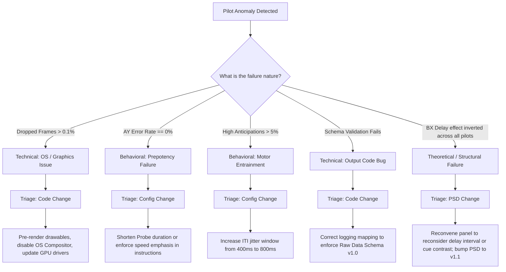

# Pilot Validation Protocol & Triage Decision Tree (Deliverable D4 Part 2)

## 1. Pilot Validation Protocol (3–5 Sessions)

### 1.1 Technical Checks
1. **Frame Drop Ratio**: $<0.1\%$ across 400 trials ($<4$ dropped frames total).
2. **Timing Drift**: Total session duration matches nominal within 1.0 second.
3. **Schema Compliance**: Pydantic schema validation passes with zero errors.

### 1.2 Behavioral Sanity Checks
1. **AX Hit Rate**: $>85\%$ in healthy adults.
2. **AY Commission Errors**: Between $10\%$ and $30\%$ (proves target prepotency).
3. **BX Delay Effect**: Long Delay ($4000\,\text{ms}$) error rate exceeds Short Delay ($1200\,\text{ms}$) error rate.
4. **Anticipation Rate**: $<3\%$ of total trials.

---

## 2. Pilot Triage Decision Tree

