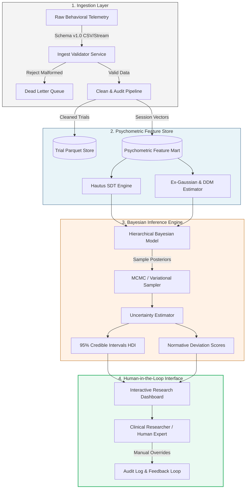

# Clinical Decision Support System (CDSS) Reasoning Architecture (Deliverable D9)

## 1. Modular Architecture Overview

The Cognitive Clinical Decision Support System is architected as an open-source, **research-use decision-support tool**. It ingests trial-level telemetry, aggregates psychometric feature vectors, computes Bayesian parameter posteriors, and presents actionable uncertainty visualizations to human researchers and clinicians.

Autonomous diagnosis, algorithmic classification labels, and deterministic clinical triage are **strictly prohibited** by design.



---

## 2. Component Interface Contracts

### 2.1 Ingestion & Validator Service
- **Input**: Raw stream/CSV conforming to `Raw Data Schema v1.0` (22 columns).
- **Operations**: Enforces types, checks 400-trial continuity, identifies duplicates, decorates rows with non-destructive cleaning flags (`flag_anticipation`, `flag_mad_outlier`).
- **Output**: Writes `cleaned_trials.parquet` and emits `SessionIngestedEvent`.

### 2.2 Psychometric Feature Store & Aggregator
- **Input**: `cleaned_trials.parquet`.
- **Operations**: Extracts per-condition descriptive metrics, Hautus log-linear SDT indices ($d'_{\text{global}}, d'_{\text{context}}, c$), latency tail metrics ($ICV, \tau$), and conflict/delay costs.
- **Output**: Data Contract 2 summary record (`subject_summaries.csv`, 24 columns).

### 2.3 Hierarchical Bayesian Inference Service
- **Input**: Summary vector $\mathbf{x}_i \in \mathbb{R}^{24}$.
- **Operations**: Fits a normative Bayesian hierarchical model against an empirical reference database ($N_{\text{ref}} \ge 500$ [verify]):
  $$P(\theta_i \mid \mathbf{X}, \mathcal{D}_{\text{norm}}) \propto P(\mathbf{X} \mid \theta_i) P(\theta_i \mid \mathcal{D}_{\text{norm}})$$
  Calculates the 95% Highest Density Interval (HDI) for context maintenance decay, vigilance decrement, and response caution.
- **Output**: JSON payload containing posterior medians, 95% HDIs, and normative percentiles.

### 2.4 Human-in-the-Loop Supervisory Interface
- **Input**: Posterior distribution payload + raw telemetry.
- **Mechanics**:
  - Displays credible intervals (violins and error bands); point estimates without uncertainty are programmatically suppressed.
  - Highlights discordance (e.g., low context $d'$ accompanied by extreme motor RT variability, flagging fatigue rather than specific context deficit).
  - Provides interactive toggles to audit sensitivity to age-matched vs. education-matched normative baselines.
- **Output**: Immutable audit log containing human annotations, reviewed intervals, manual overrides, and clinician signature.

---

## 3. Ethical Use & Clinical Boundary Statement

```
===================================================================================================
ETHICAL USE AND CLINICAL BOUNDARY STATEMENT: DELIVERABLE D9
===================================================================================================
1. RESEARCH-USE ONLY (NON-DIAGNOSTIC MANDATE):
   This system is an investigational software instrument designed solely for quantitative cognitive 
   science research and methodology development. It IS NOT cleared, certified, or intended as a 
   standalone diagnostic device (under FDA 21 CFR 860, EU MDR 2017/745, or ISO 13485). It MUST NOT be 
   used to diagnose ADHD, schizophrenia, mild cognitive impairment, or any psychiatric or neurological 
   disorder.

2. ZERO AUTONOMOUS DECISION-MAKING:
   The system is architecturally prohibited from generating automated clinical classifications, 
   diagnostic labels, triage decisions, or pharmacological/therapeutic recommendations. All outputs 
   represent descriptive psychometric estimates intended to augment, never replace, the specialized 
   judgment of a qualified human clinician or neuroscientist.

3. MANDATORY VISUALIZATION OF UNCERTAINTY:
   To prevent automation bias and false certainty, the user interface enforces the simultaneous 
   display of 95% Highest Density Intervals (HDI) alongside every estimated parameter. The rendering of 
   unqualified point estimates is programmatically disabled in the presentation layer.

4. PRIVACY-BY-DESIGN AND TENANT ISOLATION:
   Behavioral response logs constitute sensitive neurocognitive biometrics. The architecture enforces 
   end-to-end cryptographic pseudonymization: raw databases store only cryptographically hashed UUIDs, 
   with personal identifiable information (PII) segregated in an isolated, encrypted identity vault. 
   Export functions zero-out millisecond keystroke timestamps when exporting to external research 
   repositories to prevent keystroke-biometric fingerprinting.

5. INFORMED CONSENT & HUMAN OVERRIDE:
   Every data intake stream requires an authenticated digital token proving informed consent for 
   research participation. Human operators maintain absolute authority to reject, annotate, or 
   override any algorithmic metric, with all overrides recorded in an append-only audit trail.
===================================================================================================
```